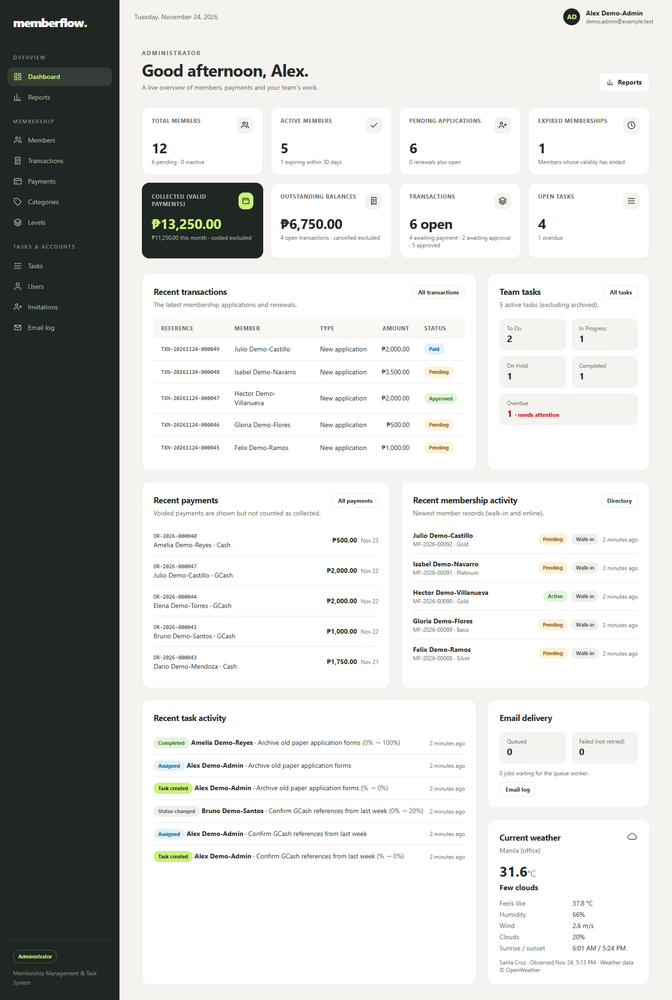

# MemberFlow

**Membership Management and Transaction Processing System with Role-Based Task Management**

MemberFlow is a Laravel 12 web application for a membership organisation, with exactly **two sign-in roles**:

- **Administrators**:
  - register members and manage categories and levels;
  - process applications, renewals and payments (partial payments, voids with reasons, approval only when fully paid);
  - assign tasks;
  - manage login accounts.
- **Members** sign in to their own portal:
  - membership status and validity, and renewal eligibility;
  - their charges, payments and printable receipts;
  - the tasks assigned to them, which they update and complete.

The public can apply online and verify their email address. Verified online applicants are invited to activate a member login automatically.



## Documentation

| Document | Contents |
|---|---|
| [docs/MemberFlow-Documentation.md](docs/MemberFlow-Documentation.md) | Full documentation: objectives, architecture, ERD, role matrix, workflows, security, testing, user guides |
| [docs/data-dictionary.md](docs/data-dictionary.md) | Every table and column, generated from the live schema |
| [docs/demo-script.md](docs/demo-script.md) | Step-by-step presentation script with expected results and speaking points |
| [docs/rubric-matrix.md](docs/rubric-matrix.md) | Grading-rubric and requirement-to-implementation verification matrix |
| [docs/testing-report.md](docs/testing-report.md) | Testing method and final results |
| [docs/email-and-security.md](docs/email-and-security.md) | Gmail SMTP, sync vs. database queue, link security, access-log redaction |
| [docs/maps-and-weather.md](docs/maps-and-weather.md) | Google Maps and OpenWeather setup and live verification |
| [docs/deployment.md](docs/deployment.md) | Local operation, backups and restore, administrator accounts, HTTPS production hosting |
| [docs/lan-demo.md](docs/lan-demo.md) | Same-Wi-Fi (phone) demonstration and how to return to local-only mode |
| [docs/known-limitations.md](docs/known-limitations.md) | Known limitations |
| [docs/screenshots/](docs/screenshots/) | Screenshots of the main screens (fictional data) |

## Requirements

- XAMPP with **PHP 8.2** and **MariaDB 10.4 / MySQL**, with the `pdo_mysql`, `mbstring`, `openssl`, `fileinfo`, `bcmath` and `intl` extensions
- **Composer 2**
- **Node.js 20.19+** and npm (to build the Tailwind CSS / Vite assets)

## Installation (Windows / XAMPP)

```bash
# 1. Start MySQL in the XAMPP Control Panel, then create the two databases:
mysql -u root -e "CREATE DATABASE memberflow CHARACTER SET utf8mb4 COLLATE utf8mb4_unicode_ci;"
mysql -u root -e "CREATE DATABASE memberflow_testing CHARACTER SET utf8mb4 COLLATE utf8mb4_unicode_ci;"

# 2. Install dependencies and configure the environment
composer install
npm install
copy .env.example .env
php artisan key:generate

# 3. In .env set MEMBERFLOW_ADMIN_EMAIL and MEMBERFLOW_ADMIN_PASSWORD (your first administrator),
#    then create the tables, the default categories/levels and that administrator:
php artisan migrate --seed

# 4. Build the front-end assets
npm run build
```

Optional fictional demonstration data. It adds 12 members (one ready to renew, one expired), 2 demo **member** login accounts and 5 tasks. It refuses to run in production and adds nothing if it has already run:

```bash
php artisan db:seed --class=DemoDataSeeder
```

## Running locally

```bash
php artisan serve                  # http://127.0.0.1:8000
```

- **Classroom demonstration:** set `QUEUE_CONNECTION=sync` in `.env`. Emails are then sent during the request (right after the database commit), so no worker is needed. Failures are recorded in the Email log and can be retried there.
- **Production:** use `QUEUE_CONNECTION=database` and keep exactly one `php artisan queue:work --tries=3` running. That gives automatic retries and fast pages.

Run `php artisan config:clear` after every `.env` change, and restart `queue:work` if you use it.

The public application form is at `http://127.0.0.1:8000/apply`.

### Stopping MariaDB safely
Use the **Stop** button in the XAMPP Control Panel, or run `C:\xampp\mysql\bin\mysqladmin.exe -u root shutdown`. **Never** end `mysqld.exe` from Task Manager or with `taskkill`: a forced kill can corrupt InnoDB data files.

## Accounts

| Account | How it is created |
|---|---|
| First administrator | `php artisan migrate --seed` (`UserSeeder`), from `MEMBERFLOW_ADMIN_EMAIL` / `MEMBERFLOW_ADMIN_PASSWORD` in `.env`. Refuses if an admin already exists |
| More administrators | `php artisan memberflow:create-admin --name="…" --email=…`. The password is typed at a hidden prompt and never shown; the creation is audited. There is no web page that creates administrators |
| Member logins | **Online applicants**: automatically invited after they verify their email. **Walk-in members**: an administrator clicks **Send activation invitation** on the member's page. The member opens the one-time link (72 h) and chooses a password; the account is linked to that member record |

**Evaluator accounts:** create a dedicated evaluation administrator with `memberflow:create-admin`, and, for the member view, activate a member account for a fictional member using Gmail "+" aliases of a test inbox you control (see `docs/deployment.md` §4). Hand the passwords over privately; never put them in documents.

## Testing

```bash
php artisan config:clear
php artisan test
```

Tests always use the separate `memberflow_testing` database (forced in `phpunit.xml` and checked by `tests/TestCase.php`). Destructive commands (`migrate:fresh`, `db:wipe`, …) are refused against any other database.

**Latest verified baseline: 632 tests, 4,410 assertions, all passing** (Nov 24, 2026). See [docs/testing-report.md](docs/testing-report.md).

## Configuration summary

| Setting | Purpose |
|---|---|
| `APP_URL` | Base address used in email links (for example `http://127.0.0.1:8000`, or the LAN address for a phone demo) |
| `APP_DEBUG` | `false` whenever anyone else can reach the app |
| `DB_*` | MySQL connection (`memberflow`) |
| `MEMBERFLOW_ADMIN_*` | First administrator, used once by the seeder (never shown in the UI) |
| `MAIL_MAILER` | `log` = written to `storage/logs/mail.log`, not delivered; `smtp` = real delivery (Gmail App Password). See `docs/email-and-security.md` |
| `QUEUE_CONNECTION` | `sync` for a classroom demo without a worker; `database` + `queue:work` in production |
| `GOOGLE_MAPS_KEY`, `OPENWEATHER_KEY` | Optional; only you enter them in `.env`. Without them the map and weather show "unavailable" and everything else works. See `docs/maps-and-weather.md` |

## Backups

```bash
C:\xampp\mysql\bin\mysqldump.exe -u root --single-transaction --routines --triggers --events memberflow > memberflow_YYYYMMDD.sql
```

To restore, load the file into a **new, empty** database first and check it. See `docs/deployment.md` §3.

## Troubleshooting

| Problem | Fix |
|---|---|
| "SQLSTATE[HY000] [2002]" | Start MySQL in XAMPP, then check `DB_HOST`, `DB_PORT` and `DB_DATABASE` in `.env` |
| Page has no styling | `npm run build`. Delete `public/hot` if it exists (left behind by `npm run dev`) |
| Emails stay "Queued" | `QUEUE_CONNECTION=database` needs `php artisan queue:work`, or switch to `sync` for a demo |
| Changed `.env` but nothing changed | `php artisan config:clear`, then restart `serve` (and `queue:work`) |
| Gmail "Username and Password not accepted" | Use a 16-character App Password (2-Step Verification on). See `docs/email-and-security.md` |
| A member cannot sign in | The login account or the member record is deactivated, or the account was never activated (send an activation invitation) |
| "Too many login attempts" | Wait one minute (5 attempts per minute per email and IP) |

---
School project (Laravel 12 / PHP 8.2), built for academic evaluation. See `docs/deployment.md` before hosting it anywhere other people can reach it.
