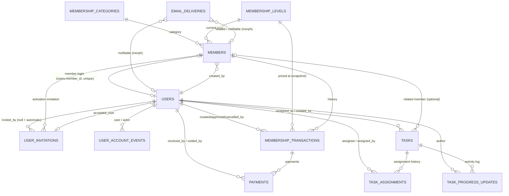

# MemberFlow — Project Documentation

**MemberFlow: Membership Management and Transaction Processing System with Role-Based Task Management**
Laravel 12 · PHP 8.2 · MariaDB 10.4 (MySQL) · Blade + Tailwind CSS v4 (Vite)

Screenshots referenced below are in [`docs/screenshots/`](screenshots/). They show fictional demonstration data only.

---

## 1. Project overview

MemberFlow manages an organisation's members and the money and work around them:

- **Membership records:** register, view, edit, deactivate or delete members, and search them by name, number, email, category, level, status or source.
- **Membership catalogue:** categories (Student, Regular, Senior Citizen, Corporate) and levels (Basic, Silver, Gold, Platinum), each level with a fee, validity period and benefits.
- **Transaction Processing System (TPS):**
  - membership **applications** and **renewals**, with official reference numbers;
  - **payments**, including partial payments and voids with reasons;
  - **approval**, allowed only when fully paid;
  - automatic **expiry**;
  - per-member transaction history;
  - printable receipts and membership records.
- **Member self-service portal:** each member can sign in to see their own membership, validity, renewal eligibility, charges, payments, receipts, notifications and tasks.
- **Role-based task management:** administrators assign **tasks** to members with an active membership. Members update progress and complete their own tasks.
- **Online access:**
  - a public **application form** with real **email verification**;
  - a private status page for applicants;
  - **member-account activation** by one-time invitation link.
- **Email:** notifications with honest delivery tracking (an *Email log*).
- **Integrations:** Google Maps location picker and read-only maps, and OpenWeather current weather. Both were verified live, and both degrade gracefully without keys.
- **Dashboards and reports:** all figures are live database aggregates.

There are exactly two account roles that can sign in: **Administrator** and **Member**.
- A member login account is linked one-to-one to its member record.
- Accounts of the retired *staff* role are kept as **legacy staff** (history only; they can never sign in).

## 2. System objectives

1. Keep accurate, searchable member records, each tied to exactly one category and one level.
2. Process applications, renewals and payments without arithmetic or status errors:
   - integer-centavo money;
   - row locking;
   - idempotent payment submission;
   - a single status-transition map.
3. Never lose history:
   - transactions and payments are never deleted, and payments are voided, not edited;
   - tasks are archived or soft-deleted, never hard-deleted;
   - accounts are deactivated, not deleted.
4. Enforce roles on the server (middleware, policies, Form Requests, service checks and database CHECK constraints).
5. Give members access to **their own** data only.
6. Be honest about external effects. An email is never reported as delivered when it was only logged, and weather is never invented.
7. Be safe to develop and test. Tests run only against `memberflow_testing`, and destructive commands are refused against the main database.

## 3. Functional requirements

| # | Requirement (professor's instructions) | Status |
|---|---|---|
| FR1 | Administrator manages categories and levels | Implemented (full CRUD, in-use delete protection, activate/deactivate) |
| FR2 | Administrator registers, edits, views and deactivates members | Implemented (plus soft delete when the member has no transactions and no login) |
| FR3 | A member belongs to one category and one level | Implemented (required foreign keys) |
| FR4 | Unique membership number | Implemented (`MF-YYYY-NNNNN`, generated from the primary key, UNIQUE index) |
| FR5 | Record new membership and renewal transactions | Implemented (`application` / `renewal` types, fee snapshot) |
| FR6 | Payments connected to a valid transaction | Implemented (foreign key + service rules: only pending transactions accept payments, never more than the balance) |
| FR7 | Only paid transactions may be approved | Implemented (status-transition map; online applicants must also have verified their email) |
| FR8 | Display transaction history and payment details | Implemented (admin history pages, receipts, and the member's own portal) |
| FR9 | Dashboard: total members, active members, pending transactions, collected payments | Implemented (and extended) |
| FR10 | Printable membership record or receipt | Implemented (both, for administrators and for the member's own record) |

Extensions:
- member login accounts and the member portal;
- task management for members;
- the public application with email verification and automatic account invitation;
- email delivery tracking;
- reports;
- maps and weather.

## 4. Technology stack

| Layer | Technology |
|---|---|
| Framework | Laravel 12 (PHP 8.2.12), MVC, Eloquent ORM, Form Requests, Policies, Events, Notifications, Queues |
| Database | MariaDB 10.4 (XAMPP MySQL), InnoDB, CHECK constraints enforced |
| Front end | Blade components, Tailwind CSS v4, Vite, vanilla JavaScript (no framework, no chart library) |
| Email | Laravel notifications (sync queue for demos, database queue in production); Gmail SMTP or log mailer |
| Integrations | Google Maps JavaScript API (browser key), OpenWeather Current Weather API (server key) |
| Testing | PHPUnit 11 (Laravel test runner), Laravel Pint, real-browser checks with installed Chrome (Playwright, outside the project) |

No third-party Composer or npm packages were added to the application beyond the Laravel 12 skeleton and Tailwind/Vite.

## 5. Installation

See [README.md](../README.md#installation-windows--xampp) and [deployment.md](deployment.md). In short:
1. Create the `memberflow` and `memberflow_testing` databases.
2. Run `composer install` and `npm install`.
3. Copy `.env.example` to `.env`, run `key:generate`, and set the first administrator in `.env`.
4. Run `php artisan migrate --seed` and `npm run build`.
5. Run `php artisan serve`. Use `QUEUE_CONNECTION=sync` for a demo, or `database` with `php artisan queue:work`.

## 6. Environment configuration

| Variable | Meaning |
|---|---|
| `APP_URL` | Base URL used in email links |
| `APP_DEBUG` | `false` whenever others can reach the app |
| `DB_DATABASE` | `memberflow` (main). Tests use `memberflow_testing` |
| `MEMBERFLOW_ADMIN_NAME/EMAIL/PASSWORD` | First administrator, created once by `UserSeeder` (refuses if an admin exists) |
| `MAIL_MAILER` | `log` (local testing, NOT delivered) or `smtp` (real delivery). No automatic fallback |
| `MAIL_HOST/PORT/SCHEME/USERNAME/PASSWORD/FROM_*` | Gmail: `smtp.gmail.com`, port `587`, `MAIL_SCHEME=null` (STARTTLS), 16-character App Password |
| `QUEUE_CONNECTION` | `sync` (demo: sent in the request after commit) or `database` (production: `php artisan queue:work`) |
| `GOOGLE_MAPS_KEY`, `GOOGLE_MAPS_MAP_ID` | Browser key (must be restricted by site address and API). Map ID defaults to `DEMO_MAP_ID` |
| `OPENWEATHER_KEY`, `OPENWEATHER_TIMEOUT`, `OPENWEATHER_CACHE_MINUTES` | Server key; 5 s timeout; 10-minute cache |
| `MEMBERFLOW_LOCATION_LABEL` | Label of the office location used by the dashboard weather (default Manila) |

Business rules live in `config/memberflow.php`:
- renewal window: 60 days;
- applicant verification link: 48 h;
- status link: 30 days;
- invitation: 72 h;
- minimum time to fill in the public form: 3 s.

## 7. Database ERD



Key design points:
- **Third normal form.** Lookups are separate tables. The fee and validity on a transaction are deliberate **snapshots**, so later price changes never alter history.
- **Cached total.** `membership_transactions.amount_paid` is a cached total, changed only under a row lock. Tests and the integrity audit assert that it always equals the sum of non-voided payments.
- **Foreign keys** use `RESTRICT`: records with history (including a member with a login) cannot be hard-deleted.
- **CHECK constraints (MariaDB-enforced):**
  - level fee ≥ 0 and validity ≥ 1;
  - transaction amount ≥ 0 and 0 ≤ amount_paid ≤ amount;
  - payment amount > 0;
  - task progress 0–100;
  - user role ∈ {admin, staff, member, legacy_staff}, and a member account **must** have a `member_id` while no other role may;
  - invitations are `member` (with `member_id`) or historical `staff` (with an inviter).
- **Unique keys:**
  - member email, `membership_no` and `public_id`;
  - `users.email` and `users.member_id` (one login per member);
  - transaction `reference_no`;
  - payment `receipt_no` and `idempotency_key`;
  - invitation `token_hash`;
  - email `dedupe_key`.

The full column-level description is in [data-dictionary.md](data-dictionary.md).

## 8. Data dictionary

See [data-dictionary.md](data-dictionary.md). It is generated from `information_schema` of the live schema and lists every column, type, default, key, foreign key and CHECK constraint of the 12 application tables.

## 9. Laravel MVC architecture

```
Request ─► routes/web.php ─► middleware (auth, active, role:admin|member, throttle, honeypot, no-referrer, SecurityHeaders)
        ─► Controller (thin) ─► Form Request (validation + authorize) / Policy (authorization)
        ─► Service (business rules, DB transactions, row locks) ─► Eloquent Models ─► MySQL
        ─► Events (after commit) ─► Listeners ─► EmailDeliveryTracker ─► Notifications (sync or queued)
        ─► Blade view (layouts + reusable components)
```

| Part | Contents |
|---|---|
| Required models | `Member`, `MembershipCategory`, `MembershipLevel`, `MembershipTransaction`, `Payment` (+ `User`, `UserInvitation`, `UserAccountEvent`, `Task`, `TaskAssignment`, `TaskProgressUpdate`, `EmailDelivery`) |
| Required controllers | `MemberController`, `CategoryController`, `LevelController`, `TransactionController`, `PaymentController` (+ dashboard, member portal, member accounts, account email, reports, tasks, my tasks, invitations, users, email log, public application, weather, profile, auth) |
| Services (`app/Services`) | `MembershipService`, `PaymentService`, `TaskService`, `InvitationService`, `MemberAccountService`, `MemberPortalService`, `UserAccountService`, `StaffRetirementService`, `ApplicantVerificationService`, `PublicApplicationService`, `EmailDeliveryTracker`, `ReportService`, `WeatherService` |
| Enums (`app/Enums`) | Statuses, types, roles and payment methods, each with `label()`/`color()`. `TransactionStatus::canTransitionTo()` is the single transition map; `UserRole::canSignIn()` is the single sign-in switch |
| Support | `Money` (string ↔ integer centavos, no floats), `NumberGenerator` (MF-/TXN-/OR- numbers), `AppUrl` (email links from `APP_URL`), `DatabaseSafety`, `FormTimer` |
| Commands | `memberflow:create-admin`, `memberflow:expire`, `memberflow:expire-invitations`, `memberflow:retire-staff` (R6 migration, dry run by default), and the local-only `memberflow:invitation-link` and `memberflow:verification-link` |
| Scheduler | `memberflow:expire` daily at 00:05; `memberflow:expire-invitations` daily at 00:10 |

## 10. Role–permission matrix

| Capability | Admin | Member | Guest |
|---|:-:|:-:|:-:|
| Sign in / sign out, own password | ✔ | ✔ | — |
| Edit own name and email | ✔ | ✘ (office-managed; sign-in email changes need confirmation) | — |
| Admin dashboard, reports, email log | ✔ | ✘ 403 | ✘ → login |
| Members, categories, levels (CRUD) | ✔ | ✘ | ✘ |
| Transactions (create, approve, cancel, expire), payments (record, void) | ✔ | ✘ | ✘ |
| Any member's record, receipts and printouts | ✔ | ✘ | ✘ |
| **Own** membership, validity, renewal eligibility, history, payments, receipts, printable record | — | ✔ | ✘ |
| Member login accounts (send/resend/revoke activation, deactivate, reactivate) and user management | ✔ | ✘ | ✘ |
| Create administrators | CLI only (`memberflow:create-admin`) | ✘ | ✘ |
| Task management (create, assign, reassign, reopen, archive, trash, restore) | ✔ | ✘ | ✘ |
| Own current tasks (update status/progress/notes) | — | ✔ (active membership only) | ✘ |
| Tasks previously assigned to me (read-only) | — | ✔ | ✘ |
| Own location map and weather (when consent is on file) | — | ✔ | ✘ |
| Weather JSON (`/weather`) | ✔ | ✔ | ✘ |
| Activate a member account (valid invitation token) | — | — | ✔ |
| Public application, verify email (signed link), status page (signed link), resend verification | — | — | ✔ |

Legacy staff accounts cannot sign in; an open session ends on the next request.

Enforcement is entirely server-side:
- middleware: `auth`, `active` (role sign-in rule + valid member link), `role`;
- policies: `TaskPolicy`, `PaymentPolicy` (member: own payments only), `MembershipTransactionPolicy`, `UserInvitationPolicy`, `UserPolicy`;
- Form Request `authorize()`, service-level checks, and database CHECK constraints.

## 11. Membership workflow

1. **Register** (Members → Register member). Enter personal details, category and level. Optionally enter coordinates, which require consent.
   - A membership number is generated.
   - With "Create a membership application now" ticked, a **pending application** is opened at the level's current fee.
   - The member's status is **Pending**.
2. **Pay** (see §12). When the balance reaches zero, the transaction becomes **Paid**.
3. **Approve** (Transaction → Approve). Allowed only for Paid transactions; online applicants must also have verified their email.
   - The member becomes **Active**.
   - Validity runs from the approval date for the level's validity period, ending the day before. For example, a 12-month level approved on Nov 12, 2026 is valid until Nov 11, 2027.
4. **Renew.** Available from 60 days before expiry, or after expiry, if there is no other open transaction. The level may change.
   - An approved renewal continues from the day after the current end date, so no days are lost.
   - If the membership had already expired, the renewal starts on the approval date.
   - Members see whether they can renew on their portal; administrators create renewals.
5. **Expire.** A daily job marks approved transactions and active members whose end date has passed as **Expired**. Admins can also run it from Transactions.
6. **Deactivate / reactivate.**
   - Deactivating keeps all history, blocks new transactions, and also blocks that member's login.
   - Reactivating restores the status implied by the dates.
   - A member can be **deleted** (soft delete) only if they have no transactions and no login account.

## 12. Transaction and payment workflow

Statuses: **Pending → Paid → Approved → Expired**, and **Pending → Cancelled**. Every transition is defined in `TransactionStatus::canTransitionTo()`.

| Action | Rule |
|---|---|
| Record payment | Only on **Pending** transactions; amount > ₱0.00, up to 2 decimals, and **not more than the balance**; Cash / GCash / Bank Transfer; generates `OR-YYYY-NNNNNN` |
| Partial payment | Allowed; status stays Pending until the balance is ₱0.00, then becomes **Paid** |
| Double submit | Each form carries a UUID idempotency key (UNIQUE). Resubmitting shows the original payment instead of creating a second one |
| Void payment | Reason required. Only before approval. The row is kept (struck through, "VOID" on its receipt); `amount_paid` is recalculated; Paid can return to Pending |
| Approve | Only Paid transactions with zero balance (and, for online applicants, a verified email) |
| Cancel | Only Pending transactions with no valid payments; reason required |
| Zero-fee level | Nothing to pay: the transaction starts as Paid |

Concurrency: every state change runs in a database transaction with `SELECT … FOR UPDATE` on the affected rows. Six simultaneous ₱300 payments on a ₱1,000 balance result in exactly three accepted payments (verified).

## 13. Task workflow (members)

1. **Admin creates a task** (Tasks → New task): title, description, priority, due date, optional related member, and an assignee.
   - **Eligible assignees** are member accounts that are active and linked to a member record with status **Active** and an end date of today or later. The form lists them as name · membership number · level · account status. The server re-checks this rule under row locks.
   - An assignment-history row and activity entries are written, and the assignee is emailed.
2. **The member updates the task** (My Tasks → task): status (To Do / In Progress / On Hold / Completed), progress 0–100 and notes.
   - 100% means Completed, and a completed task is locked until an administrator reopens it.
   - Completing a task or putting it On Hold emails the admin who created it.
   - Members whose membership is pending or has expired keep **read-only** access to their tasks.
3. **Admin monitors** the task timeline, the dashboard activity feed and Reports → Task workload. A warning appears when an unfinished task is held by someone who can no longer work on it.
4. **Reassign:**
   - the previous assignment period is closed but kept;
   - the new assignee is emailed;
   - the previous assignee keeps **read-only** access.
5. **Reopen, archive, trash and restore.** All are logged; tasks are never hard-deleted.
6. **Related members.** If a task names a related member, the assignee sees only that member's **name**, never their contact details, payments or profile.

## 14. Member accounts and activation

1. **Online applicants.** When an applicant verifies their email (§15), MemberFlow automatically emails them a member-account invitation. The invitation is recorded with no inviter (`invited_by` NULL = automatic).
2. **Walk-in members.** An administrator opens the member and chooses **Login account → Send activation invitation**. It is refused if the member already has a login, is deactivated or deleted, an invitation is already pending, or another account already uses the email.
3. **The link:** a 64-character random token. Only its SHA-256 hash is stored. It expires in 72 hours and works once.
   - It is bound to the member record **and** its current email.
   - Resend issues a new link and invalidates the old one; Revoke disables it.
   - The page refuses stale links, for example after an email change or deactivation.
4. **Activation.** The member chooses a password (at least 8 characters, upper- and lower-case letters and a number). The account is created with role **member**, linked to the member record, and signed in to the member dashboard.
   - The name and email come from the membership record; any role sent with the form is ignored.
   - Opening the link proves the member owns the address, so the member's email is marked verified.
   - Activation never approves or pays anything.
5. **Concurrency.** Eight simultaneous acceptances of one link created exactly one account (verified). Row locks plus the unique `users.member_id` and `users.email` keys guarantee it.
6. **Email changes.** When an administrator changes a member's email:
   - pending invitations are revoked;
   - an existing login keeps its sign-in email until the member opens a confirmation link sent **only to the new address while signed in**. Account ownership never moves silently.
7. **Administrators** are created only by `php artisan memberflow:create-admin` (or the first-run seeder). There is no web page that creates administrators, and members can never become administrators.
8. **Staff retirement (R6).**
   - The former staff role was retired with `memberflow:retire-staff`: one staff account was linked to its member record, and one was retired as `legacy_staff`.
   - It ran as a dry run first, then for real; every change was audited, and a guarded reversal exists.
   - Historical staff invitations, tasks and audit rows are kept unchanged.

Every account change is written to `user_account_events`.

## 15. Public application and verification workflow

1. **The applicant opens `/apply`.** It is protected by CSRF, rate limits (5 per minute and 20 per day per IP), a hidden honeypot field, and a minimum 3-second fill time with an encrypted timer.
   - Coordinates are optional and need consent.
   - A privacy notice must be accepted.
2. **Submission** uses the same `MembershipService::register()` as walk-ins, creating a **pending online member and application**.
   - The response is **identical** whether or not the email is already registered. If it is, the mailbox owner receives a short notice instead, at most once a day.
3. **A verification email** is sent with a **signed, relative** link valid for 48 hours. The link is bound to the member's random public ID and a hash of the current email.
4. **Opening the link** records `email_verified_at` and issues the member-account invitation (§14). It never pays for or approves anything.
   - Tampered or old links show a friendly "not valid" page.
   - Expired links show an "expired" page.
5. **A private status page** (signed link, 30 days) shows only the first name, reference, statuses and amounts.
6. **Resend** (`/apply/verification/resend`) always shows the same message. It is rate-limited per IP and per email, with a 60-second cooldown.
7. **Approval rule:** an **online** application can be approved only when it is fully paid **and** the email is verified. Walk-in members are exempt.

## 16. Email notification architecture

- **One entry point.** All emails go through `EmailDeliveryTracker::send()`, which creates an `email_deliveries` row first.
  - With `QUEUE_CONNECTION=sync`, the email is sent right after the database commit, in the same request.
  - With `database`, it is queued (`afterCommit`, 3 attempts with 30 s and 120 s back-off).
- **Statuses:**

  | Status | Meaning |
  |---|---|
  | **Queued** | Waiting for the worker |
  | **Sent** | Accepted by the SMTP server. Not proof of inbox delivery |
  | **Logged** | Written to the local mail log. NOT delivered |
  | **Failed** | Safe error message stored. Retry is available in the Email log |
  | **Skipped** | Fictional or reserved recipient domains (`example.com`, `.test`, …). Never dispatched |
- **No fallback.** There is no automatic SMTP → log fallback.
- **Duplicates.** A per-event `dedupe_key` prevents duplicate emails, and `shouldSend()` refuses to send a delivery that is already final or has been superseded.
- **Notifications:**
  - membership: application received (walk-in), verification (online), renewal submitted, approved, cancelled;
  - accounts: member-account activation, sign-in email change confirmation;
  - tasks: assigned, reassigned away, completed or on hold;
  - test email.
- **Links** use `APP_URL` (captured when each email is created), so they work on another device when `APP_URL` is the LAN address.
- **Admin Email log:** filters, configuration panel (no credentials shown), log-mode banner, "Send test email to me", and retry of failed deliveries.
- **Members** see a short notification summary on their dashboard: the email type and whether it was emailed. They never see error details, addresses or links.

See [email-and-security.md](email-and-security.md).

## 17. Maps and weather

See [maps-and-weather.md](maps-and-weather.md).

- **Location picker** on `/apply` and on the admin member register and edit forms:
  - click to place a marker, drag to adjust, or type coordinates;
  - "Use my current location" (only on HTTPS or localhost);
  - "Clear location".
  - Manual entry always works. Without a key, or with a rejected key, the map shows "unavailable".
- **Read-only maps:** the admin member profile, and the member's **own** "My membership" page (only while location consent is on file), each with an "Open in Google Maps" link.
- **Weather:** admin and member dashboards (office location), admin member profiles, and the member's own location. The server calls OpenWeather and the key never reaches the browser.
  - Coordinates are rounded to about 1 km before being sent.
  - Results are cached for 10 minutes and errors for 60 seconds.
  - A global budget of 50 calls per minute applies; timeouts are 3 s to connect and 5 s in total.
  - Requests are throttled per user.
- **Live status (verified 2026-11-24):**
  - The Google Maps JavaScript API loads and renders on localhost and on the LAN address with no provider errors. That shows the API is enabled and billing is active.
  - OpenWeather returns real observations that match the displayed values.
  - A rejected key on either service shows an honest "unavailable" message.

## 18. Security safeguards

| Area | Safeguard |
|---|---|
| Passwords | bcrypt, 12 rounds (`hashed` cast); strong-password rule on activation, password change and CLI admin creation |
| Authentication | Laravel session guard; 5 attempts per minute per email+IP; session regenerated on login; invalidated and CSRF token regenerated on logout. `UserRole::canSignIn()` + a valid member link are checked at login **and on every request**, so deactivated accounts, deactivated or deleted member records and legacy staff are signed out |
| Sessions / cookies | HTTP-only, SameSite=Lax, database session store. Production: `SESSION_SECURE_COOKIE=true` |
| CSRF | `@csrf` on every form; no exceptions configured |
| Authorization | Role middleware, policies, Form Request `authorize()`, service checks; members → admin pages = 403; members reach only their own records (no member id in member URLs; payment receipts checked by `PaymentPolicy`) |
| Validation & mass assignment | Form Requests for every input; `$fillable` whitelists; `role`, `member_id`, `is_active`, statuses, numbers and amounts are set only by services (`forceFill`) and are refused if mass-assigned |
| Roles in the database | CHECK constraints: allowed role values; member ⇔ `member_id`; one login per member (UNIQUE) |
| Tokens & signed links | Invitation: random 64 chars, SHA-256 hash stored, single use under row lock, 72 h, rotated on resend, bound to member + email. Applicant and email-change links: HMAC-signed, relative, expiring, bound to an email hash |
| Public form | Honeypot, minimum fill time, rate limits, enumeration-safe responses, no IDs in URLs |
| Payments | Integer centavos, row locks, idempotency key, balance check, CHECK constraints, void instead of edit/delete |
| Tasks | Assignment eligibility re-checked under row locks; progress only by the current, eligible assignee; completed and archived tasks locked |
| Database safety | Tests forced to `memberflow_testing`; `DatabaseSafety` aborts tests on any other DB; `migrate:fresh/refresh/reset/rollback` and `db:wipe` are prohibited outside the testing DB |
| Secrets | `.env` only (git-ignored, including `.env.backup*`); `.env.example` has blanks; SMTP credentials and tokens are redacted from stored error messages; the OpenWeather key never leaves the server |
| Logging | A log "tap" removes invitation tokens and `signature=` values from all application logs; mail log in log mode has links removed; `php artisan serve` output is redacted; weather logs record the failure reason only |
| HTTP headers | `X-Frame-Options: SAMEORIGIN`, CSP `frame-ancestors 'self'`, `X-Content-Type-Options: nosniff`, `Referrer-Policy` (no-referrer on token pages), `Permissions-Policy`; PHP version banner removed |
| Errors | Custom error pages (403/404/419/429/500/503) with no internals; `APP_DEBUG=false` |

## 19. Testing methodology and results

Full details: [testing-report.md](testing-report.md).

1. **Automated tests** (PHPUnit, `php artisan test`): **575 tests, 3,742 assertions, all passing**, run only against `memberflow_testing`. They cover unit and feature tests for every module, role rule, isolation rule, report figure and integration, with faked mail and faked API responses.
2. **End-to-end workflows over real HTTP** (testing database, fictional data): **48 / 48 checks.**
   - A: public application → verification → activation → member login;
   - B: payment → approval → receipt;
   - C: member task lifecycle;
   - D: renewal → new validity;
   - E: deactivation, reactivation and isolation;
   - F: maps and weather in real Chrome, including rejected keys and the LAN address.
3. **Concurrency:**
   - 6 parallel payments → exactly 3 accepted;
   - 8 parallel acceptances of one invitation → exactly 1 account;
   - 6 parallel completions of one task → exactly 1 recorded.
4. **Responsive and accessibility:**
   - real Chrome rendered 43 pages (admin, member, public) at 375, 768 and 1440 px: **0 horizontal overflow in 132 checks**;
   - the mobile menu works and keyboard focus is visible;
   - all text and badge colour pairs meet WCAG AA contrast.
5. **Main database protection.** The R6 account migration (two user rows) is the only change ever made to `memberflow` business data by this project, and it was explicitly approved. Every other check confirmed `memberflow` unchanged.

## 20. Known limitations

See [known-limitations.md](known-limitations.md). The main ones:
- It runs on plain HTTP for local and LAN demonstration only; HTTPS hosting is documented but not done.
- Members cannot reset a forgotten password themselves; an administrator re-sends access (see known limitations).
- Reports print through the browser; there is no PDF or CSV export.

## 21. Troubleshooting guide

| Symptom | Cause / fix |
|---|---|
| Database connection error | Start MySQL in XAMPP; check `DB_*` in `.env`; `php artisan config:clear` |
| Unstyled pages | `npm run build`; delete `public/hot` if present |
| Emails stay "Queued" | `QUEUE_CONNECTION=database` needs `php artisan queue:work`; or use `sync` for a demo |
| Gmail "535 Username and Password not accepted" | Use a 16-character App Password with 2-Step Verification on; `php artisan config:clear` |
| Email shows "Logged — NOT delivered" | `MAIL_MAILER=log`; switch to `smtp` for real delivery |
| Email shows "Skipped" | Recipient uses a reserved/fictional domain (e.g. `@example.test`) |
| Activation or verification link "not valid" | Use the newest link (resends replace old links); the member's email may have changed; `APP_KEY` must not change |
| Member cannot sign in | Login account or member record deactivated, or no account activated yet |
| Member cannot update a task | Their membership is not active (pending/expired) or the task is completed/archived |
| "Too many attempts" (429 or login message) | Rate limit; wait one minute |
| Map "unavailable" | `GOOGLE_MAPS_KEY` missing or not allowed for this address. Manual entry still works |
| Weather "unavailable" | `OPENWEATHER_KEY` missing, rejected, not yet activated, or the service is down |
| Tests refuse to run | They only run against `memberflow_testing`; run `php artisan config:clear` |

## 22. Administrator user guide

1. **Sign in** at `/login` (screenshot `01-login.png`). You land on the **Dashboard** (`02`) with member, payment, transaction, task, email and weather panels.
2. **Categories / Levels** (`03`, `04`): add or edit. A category or level in use cannot be deleted; deactivate it instead. Changing a level fee affects only new transactions.
3. **Members** (`05`): search by name, membership number or email, and filter by category, level, status and source.
   - **Register member** (`06`).
   - On a **member profile** (`07`):
     - edit, print the record (`13`), view the transaction history (`08`);
     - send a verification email, deactivate or reactivate;
     - **Login account:** send, resend or revoke an activation invitation, see the account status, and deactivate or reactivate the login.
4. **Transactions** (`09`, `10`):
   - **New application / Renew membership** from the member profile;
   - **Record payment** (partial allowed);
   - **Approve** when Paid;
   - **Cancel** (unpaid only, reason required);
   - **Expire due memberships**.
5. **Payments** (`11`): list and filter. On a payment: **Receipt** (`12`), or **Void** with a reason (before approval).
6. **Tasks** (`14`): create and assign to eligible members, reassign, reopen, archive, trash and restore; the timeline shows every update.
7. **Users and invitations** (`15`): see every login account and activation invitation; deactivate or reactivate accounts. New administrators: `php artisan memberflow:create-admin` on the server.
8. **Reports**: choose a period; read membership, transactions, collections, outstanding balances, tasks and task workload; **Print**.
9. **Email log**: see each email's status; **Send test email to me**; **Retry** failed emails.

## 23. Member user guide

1. **Activate your account.** Open the activation email ("Activate your MemberFlow member account"), choose a password, and you are signed in. Online applicants receive it right after verifying their email; walk-in members receive it from the membership office.
2. **Dashboard:**
   - your membership status, validity dates and days remaining;
   - what you still need to do (for example "waiting for payment" or "awaiting approval") and whether renewal is available;
   - your balance;
   - your tasks, with counts, overdue items and deadlines;
   - recent activity, your notifications, and the office weather.
3. **Membership:**
   - your details and email verification;
   - category, level and benefits;
   - application and renewal history;
   - renewal eligibility;
   - **Print my record**;
   - your location on file and its weather, if you agreed to store it.
4. **Payments:** total charges, total paid, balance due, every payment (voided ones are marked and not counted), and printable **receipts**.
5. **My Tasks / Task history:** open a task, set status and progress, add a note, and **Save update**. Completing a task notifies the administrator. If your membership is not active, your tasks are read-only.
6. **Profile:** change your password. Your name and email are kept by the membership office. If they change your email, confirm the new address from the link sent to it while you are signed in.

You only ever see your own membership, payments and tasks.

## 24. Public applicant guide

1. Open **Apply** (`/apply`, screenshot `17`). Fill in your details, choose a category and level (the fee, validity and benefits are shown), optionally set your location with consent, accept the privacy notice and submit.
2. Check your email and click **Verify my email address** within 48 hours. Check your spam folder too. Lost the email? Use **Resend the verification email** (`/apply/verification/resend`).
3. After verifying, you also receive an email to **activate your member account** (see §23).
4. Verifying does not activate your membership. Pay the fee at the office; an administrator approves your application, and you receive an approval email.
5. Use the private status link from your email (valid for 30 days) to see your reference, status, amount due, amount paid and balance.
